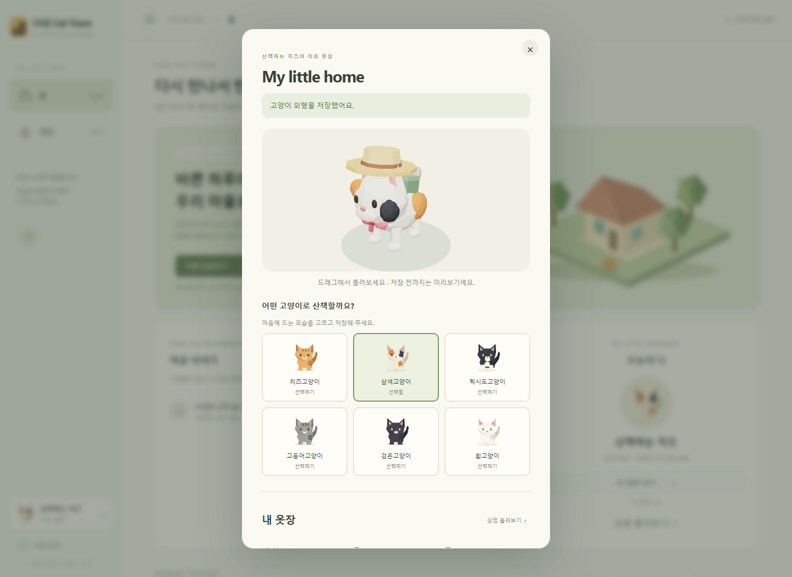

# CHZ Cat Town 🐾

고양이가 되어 작은 3D 마을을 산책하고, 이야기를 남기고, 나만의 모습을 꾸미는 웹서비스입니다.

**MVP v0.3** — React 게임 화면에 FastAPI · PostgreSQL을 연결했습니다. Docker Compose로 프런트엔드, API, DB를 함께 실행합니다.



[홈 화면](docs/images/home.png) · [소품을 장착한 마을 화면](docs/images/equipped-town.png)

## 빠른 시작

Docker Desktop의 Linux 컨테이너 엔진과 Docker Compose가 필요합니다. 실행 중인 Docker Desktop을 확인한 후 프로젝트 폴더에서:

```sh
docker compose up -d --build
```

- 웹: **http://localhost:5180**
- API 문서: http://localhost:8000/docs
- 상태 확인: `docker compose ps`
- 로그: `docker compose logs -f backend`
- 종료: `docker compose down`

첫 빌드에는 이미지 다운로드 시간이 필요합니다. DB가 준비되면 Alembic 마이그레이션과 상점 상품 등록이 자동 실행됩니다. `.env` 없이 개발 기본값으로 실행할 수 있습니다. 포트나 설정을 바꾸려면 `.env.example`을 `.env`로 복사해 수정하세요. 웹 포트를 변경하면 `ALLOWED_ORIGINS`에도 정확한 주소를 추가해야 합니다.

`docker compose down` 후 다시 실행해도 데이터는 `town-data` 볼륨에 유지됩니다. **`down -v`는 DB 볼륨까지 지우므로 일반 종료에 사용하지 마세요.** DB 포트는 호스트에 공개하지 않으며 개발 웹/API는 로컬 컴퓨터에서만 접속하도록 바인딩합니다.

## 사용하기

1. 비회원으로 마을을 둘러보거나 **로그인 / 회원가입**에서 계정을 만듭니다. 비밀번호는 10~128자입니다.
2. 가입 시 테스트 코인 **1,000개**를 한 번 받습니다. 실물 화폐 결제나 코인 충전은 없습니다.
3. 홈의 **상점 둘러보기** 또는 마을의 Cat Shop에서 소품을 구매합니다.
4. **내 고양이 보기 → 내 옷장**에서 6종 고양이와 보유 소품을 조합합니다. 3D 미리보기를 드래그해 돌려볼 수 있습니다.
5. **외형 저장**을 누르면 계정에 저장됩니다. **변경 취소**, 닫기, ESC는 저장 전 미리보기를 되돌립니다.
6. 프로필 닉네임·자기소개는 **프로필 저장**으로 별도 저장합니다. 게시판은 로그인 후 글쓰기·본인 글 수정·삭제가 가능합니다.

| 상품           | 장착 위치 | 가격 |
| -------------- | --------- | ---: |
| 산책 밀짚모자  | 머리      |  300 |
| 딸기 리본      | 목        |  200 |
| 작은 산책 가방 | 등        |  450 |

각 상품은 계정당 한 번 구매할 수 있습니다. 치즈·삼색·턱시도·고등어·검은·흰고양이 6종은 기본 제공입니다. 로그인한 외형·아이템·프로필·코인·게시글은 PostgreSQL에 저장되며 재접속과 다른 브라우저 로그인에도 유지됩니다. 비회원 고양이 종류와 사이드바 상태만 해당 브라우저에 저장됩니다.

## 게임 조작

기본 맵은 80×70 월드 단위로, 중앙 광장·서쪽 공원·동쪽 정원·남쪽 잔디마당과 외곽 주택 구역을 연결합니다. 중앙 시설 주변 도로와 외곽 순환 산책로를 따라 둘러볼 수 있고, 공원에는 여러 주민이 함께 머물 수 있는 열린 공간과 벤치를 배치했습니다. 카메라는 넓어진 맵 끝까지 고양이를 따라갑니다.

| 입력 / 버튼    | 동작                                            |
| -------------- | ----------------------------------------------- |
| WASD / 방향키  | 화면 방향 기준 걷기                             |
| E              | 근처 게시판·상점·집 열기                        |
| ESC / 닫기     | 모달 닫기 (저장·구매 처리 중에는 기다려 주세요) |
| 전체화면       | 게임 화면 확장                                  |
| 좌측 메뉴 버튼 | 사이드바 숨기기 / 펼치기                        |
| 홈 / 게임      | 대시보드와 마을 전환                            |

WebGL 2를 지원하는 데스크톱 브라우저와 키보드를 권장합니다. 모바일에서는 계정·게시판·상점·옷장을 사용할 수 있지만 게임 이동은 키보드가 필요합니다. 홈으로 돌아가면 게임이 일시 정지되고, 다시 들어가면 산책 위치를 유지합니다. 브라우저를 새로고침하면 산책은 시작 위치에서 재개됩니다.

## 개발

| 영역   | 기술                                                              |
| ------ | ----------------------------------------------------------------- |
| 웹 UI  | React 19, TypeScript, Vite, Zustand, TanStack Query               |
| 게임   | Three.js, React Three Fiber, Drei, Rapier                         |
| API    | Python 3.12, FastAPI, Pydantic                                    |
| 저장   | PostgreSQL 16, SQLAlchemy, Alembic                                |
| 인증   | Argon2 비밀번호 해시, HttpOnly 서버 세션 쿠키, CSRF + Origin 검증 |
| 테스트 | pytest + 실제 PostgreSQL, Playwright                              |

Docker 개발 환경은 `src/`와 `backend/` 변경을 반영합니다. 의존성을 변경하면 다시 빌드하세요. Python 설치 범위는 `backend/requirements.txt`, 검증된 전체 버전은 `backend/requirements.lock`에 기록하며 Docker는 lock 파일을 사용합니다.

호스트의 Node.js로 프런트엔드를 개발할 수도 있습니다 (Node 22.12 이상, 권장 24):

```sh
docker compose up -d db backend
npm ci
npm run dev
```

이 경우 웹 주소는 http://localhost:5173 입니다. Vite가 `/api` 요청을 http://localhost:8000 으로 프록시합니다. API만 다른 주소에서 실행한다면 `.env`의 `API_PROXY_TARGET`을 설정하세요. `npm run preview`는 정적 빌드 확인용이며 API 프록시는 제공하지 않습니다.

```text
src/
  api/             API 클라이언트, CSRF, QueryClient
  features/        홈, 인증, 게시판, 상점, 프로필/3D 옷장
  components/      앱 레이아웃, 게임 캔버스, 모달
  game/            월드, 물리, 이동, 3D 고양이/소품, EventBus
  stores/          세션, UI, 저장된 외형과 미리보기
  types/           API 데이터 타입
backend/
  app/             FastAPI 라우트, 모델, 인증, 상품 초기 데이터
  migrations/      Alembic DB 스키마 이력
  tests/           격리된 PostgreSQL 테스트
 docker/           프런트엔드 Dockerfile, Nginx 설정
 tests/            게임 회귀 테스트, 실제 API 통합 테스트
```

설계와 저장 규칙은 [docs/architecture.md](docs/architecture.md)를 참고하세요.

## 검증

```sh
npm run build
npx playwright install chromium
npm test
docker compose exec backend python -m pytest -q
```

- `npm test`: API를 고정한 게임 이동·충돌·전체화면·고양이 6종·홈/게임 전환 회귀 테스트. 5173 개발 서버를 자동 실행하거나 재사용합니다.
- pytest: 매번 `chz_test_<random>` 임시 DB를 만들고 마이그레이션한 뒤 테스트 종료 시 삭제합니다. 개발용 DB 계정에 DB 생성 권한이 필요합니다. 서비스 데이터는 변경하지 않습니다.
- 실제 API 브라우저 통합 테스트는 아래 **격리된** Docker 프로젝트에서 실행합니다 (PowerShell).

```powershell
$env:WEB_PORT='5181'
$env:API_PORT='8001'
$env:ALLOWED_ORIGINS='http://localhost:5181'
docker compose -p chz-cat-town-e2e up -d --build
npm run test:integration
# 테스트 환경만 삭제합니다. 일반 개발 환경의 종료 명령과 다릅니다.
docker compose -p chz-cat-town-e2e down -v
Remove-Item Env:WEB_PORT, Env:API_PORT, Env:ALLOWED_ORIGINS
```

통합 테스트는 가입·로그인·로그아웃·프로필 저장·게시판 CRUD·구매·장착·재접속·외형 충돌·세션 만료·모바일 폼을 확인합니다. 테스트 화면은 `test-results/`에 저장됩니다.

## DB 변경과 백업

모델 변경 후 마이그레이션 파일을 생성하고 내용을 검토한 뒤 적용합니다.

```sh
docker compose exec backend alembic revision --autogenerate -m describe_change
docker compose exec backend alembic upgrade head
docker compose exec backend alembic check
```

Windows 셸의 바이너리 리다이렉션 차이를 피하려면 DB 컨테이너 내부에 백업을 만든 후 복사하세요.

```sh
docker compose exec db pg_dump -U chz -d chz -Fc -f /tmp/chz-backup.dump
docker compose cp db:/tmp/chz-backup.dump ./chz-backup.dump
```

복구 시에는 사용 중인 DB에 덮어쓰지 말고 별도 DB를 만들어 먼저 확인합니다. 백업에는 계정과 게시글이 포함되므로 Git에 커밋하지 않습니다.

## 배포용 구성

`compose.production.yaml`은 개발 구성과 **별도로** 사용합니다. 정적 빌드 + Nginx API 프록시, 소스 볼륨 없는 API, 영구 DB 볼륨으로 구성합니다.

1. `.env`에 강한 URL-safe `POSTGRES_PASSWORD`와 실제 **HTTPS** 주소인 `ALLOWED_ORIGINS`를 설정합니다. 예: `https://cats.example.com` (끝 `/` 제외).
2. `docker compose -f compose.production.yaml up -d --build`
3. 호스트의 HTTPS 리버스 프록시에서 `127.0.0.1:5180`으로 연결합니다. 인증서는 이 구성에 포함되어 있지 않습니다.

운영 구성은 Secure 세션 쿠키를 사용하므로 HTTPS가 필요합니다. 개발 구성과 동시에 띄우려면 다른 `WEB_PORT`를 사용하세요. 운영 프로젝트명/볼륨은 개발 환경과 분리됩니다. 기존 DB의 비밀번호 변경은 `.env` 수정만으로 적용되지 않으므로 DB 역할 비밀번호도 함께 변경해야 합니다.

현재 범위는 싱글 플레이 마을과 기본 커뮤니티입니다. 실시간 멀티플레이, 이미지 업로드, 이메일 인증/비밀번호 재설정, 관리자·신고 도구, 실결제는 포함하지 않습니다. 3D 엔진/WASM 파일이 커서 최초 게임·옷장 진입에 로딩 시간이 있습니다.
