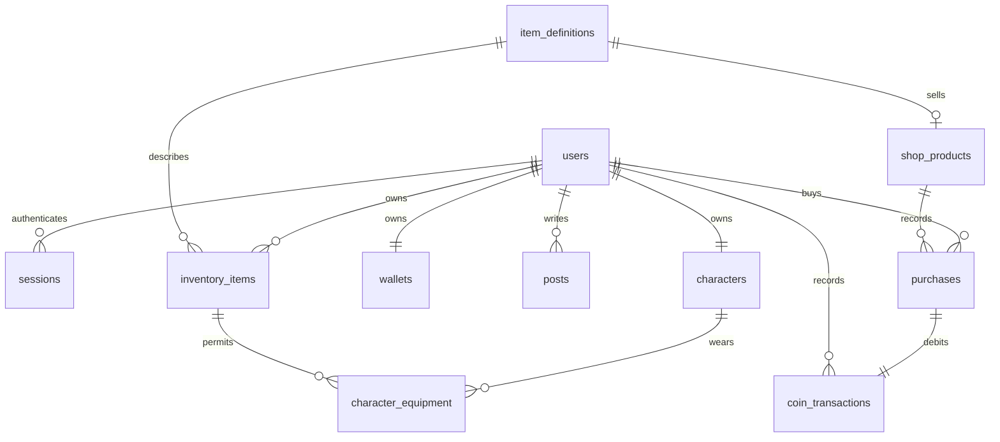

# v0.3 저장 구조와 API

React UI는 같은 출처의 `/api`로 요청합니다. 개발에서는 Vite, 배포에서는 Nginx가 FastAPI로 전달합니다. API만 PostgreSQL에 접근합니다. 게임 프레임의 위치·속도·키 입력은 메모리에 유지하고, 계정·프로필·외형·구매·게시글을 저장합니다.

## 인증

회원가입은 사용자·고양이·지갑·가입 보상 원장을 하나의 트랜잭션으로 만듭니다. 비밀번호는 Argon2로 해시합니다. 무작위 세션 토큰은 HttpOnly/SameSite=Lax 쿠키에, 토큰의 SHA-256 해시와 7일 만료 시각은 DB에 저장합니다. 로그인 응답의 CSRF 토큰은 프런트엔드 메모리에만 보관하고 변경 요청의 `X-CSRF-Token`에 넣습니다. 로그인/가입을 포함한 변경 요청은 허용된 `Origin`도 확인합니다.

로그아웃은 서버 세션과 쿠키를 제거합니다. 보호 API의 401 응답은 프런트엔드 계정·Query 캐시·장착 소품을 초기화합니다. 인증 요청 제한은 DB 기반 IP당 분당 20회입니다. 현재 프록시 환경에서는 API가 보는 프록시 IP 기준으로 집계하므로 공개 서비스 확장 시 신뢰할 프록시/IP 전달 정책 및 인증 요청 제한을 함께 조정해야 합니다.

## 구매와 외형

클라이언트가 보내는 상품 ID만 사용하고 가격·잔액·소유 여부는 서버에서 확인합니다. 구매는 지갑 행 잠금 → 중복 요청 확인 → 상품·잔액·소유 검사 → 구매 기록·코인 원장·인벤토리·잔액을 한 트랜잭션으로 저장합니다. 요청 UUID는 사용자별로 유일하며 재시도하면 기존 결과를 반환합니다. 동일 키를 다른 상품에 재사용하면 409입니다. 구매 UUID는 응답 불확실 시 재시도할 수 있도록 프런트엔드 메모리와 sessionStorage에 보관합니다.

인벤토리는 `(user_id, item_id)`가 유일합니다. 장착은 보유 아이템인지와 머리/목/등 슬롯 일치 여부를 검사합니다. 캐릭터 `version`이 현재 DB와 다르면 409를 반환해 다른 탭의 저장을 덮어쓰지 않습니다. UI는 저장된 외형과 임시 미리보기를 구분하고, 취소·모달 종료·로그아웃 시 임시 외형을 버립니다. 구매 및 외형 저장 중 모달 종료는 잠깐 막습니다.

## 게시판

누구나 목록과 본문을 읽을 수 있고 로그인한 사용자가 글을 작성합니다. 수정·삭제 권한은 서버가 작성자 ID로 검사합니다. 본문은 HTML이 아닌 일반 텍스트로 렌더링합니다. 목록은 ID 내림차순 커서 페이지네이션이며 한 번에 최대 50개입니다. 탈퇴·댓글·검색·관리자 기능은 후속 범위입니다.

## API

요청 필드 상세는 실행 중인 `/docs`의 OpenAPI 문서에서, 응답 데이터 타입은 `src/types/api.ts`에서 확인할 수 있습니다.

| 메서드             | 경로                                            | 기능                               |
| ------------------ | ----------------------------------------------- | ---------------------------------- |
| GET                | `/api/health`                                   | DB 연결 상태                       |
| POST               | `/api/auth/signup`, `/api/auth/login`           | 가입 / 로그인                      |
| GET                | `/api/auth/session`                             | 사용자, CSRF 토큰, 저장된 외형     |
| POST               | `/api/auth/logout`                              | 세션 폐기                          |
| GET, PATCH         | `/api/users/me`                                 | 닉네임·자기소개                    |
| GET, PATCH         | `/api/characters/me`                            | 종류·장착 소품·version             |
| GET                | `/api/inventory/me`                             | 보유 소품                          |
| GET                | `/api/shop/products`                            | 판매 상품                          |
| POST               | `/api/shop/purchases`                           | 구매 (`Idempotency-Key` 헤더 필수) |
| GET                | `/api/wallet/me`, `/api/wallet/me/transactions` | 잔액 / 최근 50개 원장              |
| GET, POST          | `/api/posts`                                    | 목록 / 작성                        |
| GET, PATCH, DELETE | `/api/posts/{id}`                               | 조회 / 수정 / 삭제                 |

상품 정의·카탈로그는 `backend/app/seed.py`에 있으며 재시작 시 없는 항목만 생성합니다. 기존 상품 가격이나 정의 변경은 명시적인 마이그레이션으로 수행하세요. 컨테이너 시작은 Alembic 적용 후 seed를 실행하며 사용자·게시글 샘플은 생성하지 않습니다.
